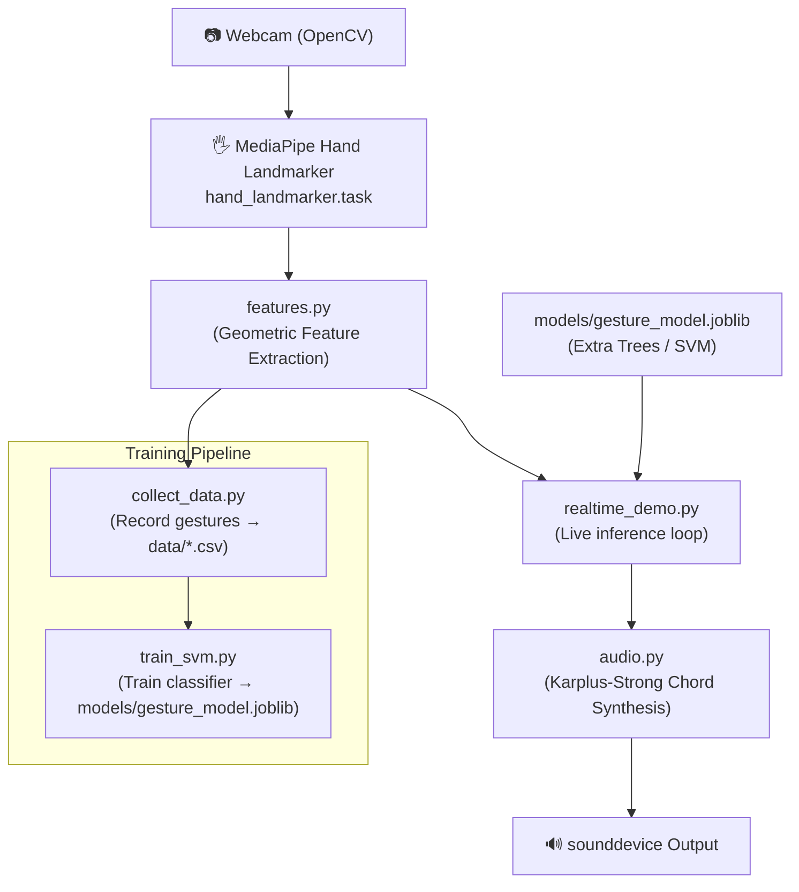

# 🎸 Air Gesture Instrument — Full Project Explanation

## What Is This Project?

This is an **AI-powered air guitar/chord instrument** — you use hand gestures in front of your webcam to select and play musical chords. No physical instrument needed. Your **right hand** shows a number gesture (1–7) to select a chord, and your **left hand** pinches to strum/play it.

---

## High-Level Architecture



---

## File-by-File Breakdown

---

### 1. [`features.py`](file:///d:/Projects/cv-project/features.py) — The Shared Math Library

This is the **brain shared by all other files**. It converts raw hand landmark coordinates into meaningful numbers that a machine learning model can understand.

#### Key Concepts

**MediaPipe gives you 21 landmarks** (numbered 0–20) for each hand — wrist, knuckles, fingertip joints, etc.

```
FINGERS = {
    "thumb":  [1, 2, 3, 4],
    "index":  [5, 6, 7, 8],
    "middle": [9, 10, 11, 12],
    "ring":   [13, 14, 15, 16],
    "pinky":  [17, 18, 19, 20],
}
TIPS = [4, 8, 12, 16, 20]  # fingertip IDs
```

#### Functions

| Function | What it does |
|---|---|
| `landmarks_to_array(hand_landmarks, w, h)` | Converts MediaPipe's normalized (0–1) coordinates to pixel coordinates as a `(21, 3)` NumPy array |
| `pick_hand(result, wanted_label)` | Finds a specific "Left" or "Right" hand in MediaPipe's result |
| `pick_gesture_hand(result)` | With 2 hands: picks the one on the **right** of screen; with 1 hand: picks that one |
| `draw_hand(frame, lm_list, w, h, color)` | Draws the hand skeleton on the webcam frame using OpenCV lines and circles |
| `palm_width(pts)` | Distance between knuckle 5 (index base) and knuckle 17 (pinky base) — used as a scale-normalizer |
| `extract_features(pts)` | **The main feature extractor** — produces a **39-element vector** |
| `pinch_ratio(pts)` | Thumb tip (4) to index tip (8) distance, normalized by palm width. Small = pinching |

#### `extract_features()` — How 39 Numbers Are Made

For each of the 5 fingers:
1. **Segment lengths** (4 segments per finger = 20 total): distance between each bone segment, divided by palm width. This makes the features **scale-invariant** (works close or far from camera).
2. **Joint angles** (3 angles per finger = 15 total): the bend angle at each joint using the dot-product formula.
3. **Adjacent fingertip distances** (4 pairs): distance between consecutive fingertips (thumb-index, index-middle, middle-ring, ring-pinky), divided by palm width.

**Total: 20 + 15 + 4 = 39 features**

---

### 2. [`audio.py`](file:///d:/Projects/cv-project/audio.py) — The Sound Engine

Generates **real guitar-like plucked string sounds** using the **Karplus-Strong algorithm** — a classic digital signal processing technique that simulates a plucked string.

#### The Chord Map

```python
CHORDS = {
    1: ("C",    [48, 52, 55, 60, 64]),   # C major
    2: ("Dm",   [50, 57, 62, 65]),        # D minor
    3: ("Em",   [52, 59, 64, 67]),        # E minor
    4: ("F",    [53, 57, 60, 65]),        # F major
    5: ("G",    [55, 59, 62, 67]),        # G major
    6: ("Am",   [57, 60, 64, 69]),        # A minor
    7: ("Bdim", [59, 62, 65, 71]),        # B diminished
}
```
These are the **7 diatonic chords in C major** — the gesture numbers 1–7 correspond directly to these chords.

Numbers are **MIDI note numbers** (standard: 69 = A4 = 440 Hz).

#### Key Functions

**`midi_to_freq(m)`** — Converts a MIDI number to Hz using the formula:
```
freq = 440 × 2^((m - 69) / 12)
```

**`pluck(freq, dur, decay)`** — The **Karplus-Strong algorithm**:
1. Fill a short buffer (delay line) with random noise
2. For each sample output: read current buffer value
3. Average adjacent buffer values and multiply by `decay` (0.996) — this smooths and attenuates the signal over time
4. The result sounds like a plucked guitar string!

**`render_chord(notes, strum_ms=25)`** — Stacks multiple plucked notes with a small strum delay (25ms between strings) to create a realistic chord strum.

**`ChordPlayer` class** — The core audio player:
- **At startup**: pre-renders all 7 chords into NumPy float arrays (`buffers` dict)
- Opens a **persistent low-latency `sounddevice` output stream** so there's zero delay when you trigger a chord
- **`_callback()`**: The audio driver calls this every ~5ms to fill its buffer. It mixes up to 3 active "voices" (playing chords) together, then clips to [-1, 1]
- **`play(number)`**: Non-blocking trigger — just appends the chord's pre-rendered buffer to the active voices list
- **`close()`**: Cleans up the audio stream

---

### 3. [`collect_data.py`](file:///d:/Projects/cv-project/collect_data.py) — The Data Recorder

An **interactive GUI tool** for recording training data. Run it as:
```bash
python collect_data.py --person YourName
```

#### What it does

1. Opens your webcam in a mirrored (selfie) view
2. Shows an on-screen control panel with gesture buttons [G1]–[G7]
3. When recording, for every frame where a hand is detected:
   - Calls `extract_features()` to get the 39-number vector
   - Writes `[label, feat1, feat2, ..., feat39]` as a CSV row to `data/YourName.csv`
4. **Target: 150 samples per gesture** (7 gestures = 1,050 rows minimum)
5. Auto-advances to the next gesture with a 3-second countdown when a gesture is complete

#### UI Controls

| Control | Action |
|---|---|
| `SPACE` or click `START REC` | Toggle recording |
| Keys `1`–`7` or click [G1]–[G7] | Switch active gesture |
| `N` / click `NEXT >` | Advance to next gesture |
| `Q` or `ESC` | Quit and save |

#### Smart Features
- **Resumes existing data**: if `data/YourName.csv` already has rows, it counts them and starts from the first incomplete gesture
- **Hand detection**: uses MediaPipe's IMAGE mode (synchronous, one frame at a time)
- **Progress bar**: visual progress toward 150 samples per gesture

---

### 4. [`train_svm.py`](file:///d:/Projects/cv-project/train_svm.py) — The Model Trainer

Trains a gesture classifier on all collected CSV data. Run as:
```bash
python train_svm.py            # saves Extra Trees (default)
python train_svm.py --model svm  # saves SVM instead
```

#### `load()` — Data Loading

- Reads every `data/*.csv` file
- CSV format: `label, feat1, feat2, ..., feat39`
- Returns `X` (features), `y` (labels), `g` (person names for LOPO)

#### Two Model Options

| Model | Implementation | Notes |
|---|---|---|
| **Extra Trees** (default) | `ExtraTreesClassifier(n_estimators=150)` | Fast, no scaling needed |
| **SVM** | `StandardScaler` + `SVC(kernel='rbf', C=10)` | Needs scaling, can be more accurate |

#### Two Evaluation Strategies

| Strategy | How | Why |
|---|---|---|
| **Random Split** (20% test) | `train_test_split` | Optimistic — consecutive video frames appear on both sides |
| **Leave-One-Person-Out (LOPO)** | Train on N-1 people, test on the 1 held out | Honest — tests true generalization to new users |

For LOPO, it prints per-gesture recall and per-person accuracy + confusion matrices.

#### Final Model

After evaluation, trains on **all complete people's data** and saves to:
```
models/gesture_model.joblib
```

#### Current Data (5 people recorded)
```
data/Thara.csv    (419 KB)
data/nirthya.csv  (419 KB)
data/pavi.csv     (972 KB)
data/vaishh.csv   (323 KB)
data/varsh.csv    (847 KB)
```
Trained model saved as `models/gesture_model.joblib` (~8.7 MB)

---

### 5. [`realtime_demo.py`](file:///d:/Projects/cv-project/realtime_demo.py) — The Live Instrument

The main program. Run it after training:
```bash
python realtime_demo.py
```

#### Startup
1. Loads the trained model from `models/gesture_model.joblib`
2. Creates a `ChordPlayer` (pre-renders all chords)
3. Opens webcam + MediaPipe hand detector (2 hands, IMAGE mode)

#### The Main Loop (every webcam frame)

```
1. Capture frame → flip horizontally (selfie view)
2. Run MediaPipe hand detection
3. Assign roles to detected hands
4. Run gesture classification on chord hand
5. Run pinch detection on strum hand
6. Draw UI overlays
7. Handle key presses
```

#### Hand Role Assignment (the clever part)

With **2 hands** detected:
- Average the x-coordinates to find which is left/right on screen
- `left_side` → **Strum hand (t_hand)** — pinches to play
- `right_side` → **Chord hand (g_hand)** — shows number gesture

With **1 hand** detected:
- If it's on the left half (x < 0.5): assigned as **strum hand only**
- If it's on the right half: assigned as **chord hand only**

Press **`S`** to swap roles at any time.

#### Gesture Classification

```python
feats = extract_features(landmarks_to_array(g_hand, w, h))
votes.append(int(model.predict(feats[None, :])[0]))
current = Counter(votes).most_common(1)[0][0]
```
- A **deque of 3 votes** (last 3 frames) is used — the majority vote wins
- This **temporal smoothing** prevents flickering between gestures

#### Pinch Detection

```python
PINCH_ON  = 0.32   # ratio below this = pinching
PINCH_OFF = 0.40   # ratio above this = open (hysteresis)
```
- Uses **hysteresis** (two thresholds) to prevent rapid on/off toggling
- On first pinch: plays the chord immediately
- While holding pinch: 
  - If chord changes → plays new chord instantly
  - Same chord held → re-strums every 0.5 seconds (`STRUM_INTERVAL`)

#### Visual Feedback

| Element | Color | Meaning |
|---|---|---|
| Green hand skeleton | `(0, 255, 100)` | Chord hand (gesture recognition) |
| Orange hand skeleton | `(0, 165, 255)` | Strum hand (ready) |
| Cyan hand skeleton | `(0, 255, 255)` | Strum hand (actively pinching!) |
| Cyan circles + line | between thumb & index | Pinch contact visualization |
| Top HUD bar | semi-transparent dark | Shows current chord + strum status |

---

## How All Files Connect Together

```
STEP 1 — DATA COLLECTION
collect_data.py
  uses → features.py (extract_features, draw_hand, pick_gesture_hand)
  uses → mediapipe (hand_landmarker.task)
  writes → data/PersonName.csv

STEP 2 — TRAINING
train_svm.py
  reads → data/*.csv
  trains → sklearn model
  saves → models/gesture_model.joblib

STEP 3 — LIVE DEMO
realtime_demo.py
  uses → features.py (extract_features, landmarks_to_array, pinch_ratio, draw_hand)
  uses → audio.py (ChordPlayer, CHORDS)
  uses → mediapipe (hand_landmarker.task)
  loads → models/gesture_model.joblib
  → plays chords through speakers
```

---

## The Complete Data Flow During Live Play

```
Webcam Frame
    ↓ (flip horizontal)
MediaPipe Hand Landmarker
    ↓ (21 normalized landmarks per hand)
landmarks_to_array()
    ↓ (21×3 pixel coords)
extract_features()
    ↓ (39 geometric features)
gesture_model.predict()
    ↓ (label 1–7, majority-voted over 3 frames)
current = chord number
    ↓
pinch_ratio() on strum hand
    ↓ (< 0.32 = pinch detected)
ChordPlayer.play(current)
    ↓ (non-blocking)
sounddevice callback mixes voices
    ↓
🔊 Guitar chord sound!
```

---

## Key Design Decisions

| Decision | Why |
|---|---|
| **Scale-normalize features by palm width** | Works at any distance from camera |
| **39 geometric features, not raw pixels** | Robust to position/scale changes; interpretable |
| **Pre-render chords at startup** | Zero latency when triggering — no real-time synthesis delay |
| **Persistent audio stream with callback** | Low-latency output; avoids stream startup overhead per chord |
| **3-frame majority voting** | Prevents gesture flickering between frames |
| **Hysteresis for pinch (0.32/0.40)** | Prevents rapid on/off chattering at the threshold |
| **Leave-One-Person-Out evaluation** | Gives an honest measure of how the model generalizes to new users |
| **Extra Trees as default** | Fast inference, no scaling required, competitive accuracy |
| **Separate hand roles** | Allows simultaneous chord selection AND strumming — like a real instrument |
